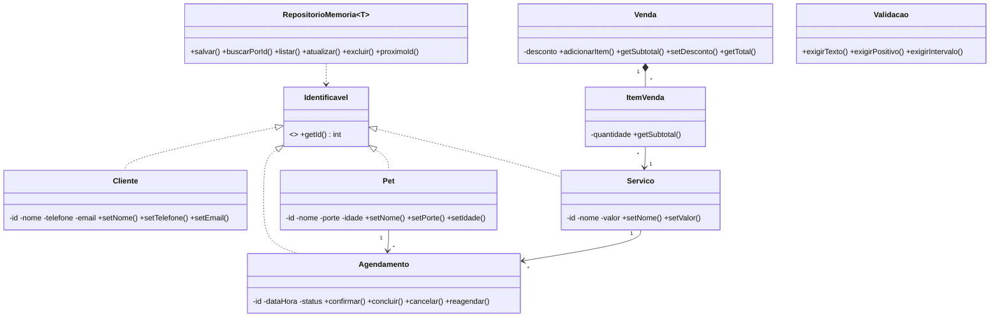

# 🐾 Sistema Pet Shop & Clínica Veterinária

> Trabalho Prático Final (A3) da disciplina de **Gestão e Qualidade de Software**.

---

## 📌 1. Sobre o Projeto

Sistema desktop voltado ao apoio operacional e administrativo de pet shops e clínicas veterinárias. A solução centraliza o controle cadastral de clientes e animais, catálogo de procedimentos e o fechamento financeiro de atendimentos prestados.

* **Tema:** PetShop / Veterinária
* **Escopo:** Operações completas de CRUD (cadastrar, consultar, alterar e excluir) orientadas a objetos com cobertura de testes unitários.

---

## 👥 2. Integrantes da Equipe

* 👤 **Diego Manini** - RA 32424894
* 👤 **Yago Siqueira** - RA 325144526
* 👤 **Diogo Marx Lopes** - RA 325132950

---

## 🛠️ 3. Tecnologias & Ferramentas

* ☕ **Java 17**
* 📦 **Apache Maven** (Gerenciamento de dependências e build)
* 🧪 **JUnit 5 (Jupiter)** (Framework de testes unitários)
* 🐙 **Git & GitHub** (Versionamento e fluxo de colaboração)

---

## 🏛️ 4. Estrutura do Domínio (Entidades)

O sistema conta com 6 classes principais de domínio com atributos privados e encapsulamento, além de `Validacao` (regras reutilizáveis) e `RepositorioMemoria` (CRUD genérico em memória):

1. 👤 `Cliente` — Cadastro completo dos tutores (ID, nome, telefone, email).
2. 🐕 `Pet` — Animais atendidos no PetShop (ID, nome, porte, idade).
3. ✂️ `Servico` — Catálogo de itens disponíveis (banho, tosa, vacina, consulta) com valores base.
4. 📅 `Agendamento` — Marcação e controle de status de horários de atendimento.
5. 📋 `ItemVenda` — Discriminação individual de cada serviço prestado na ordem de serviço.
6. 💳 `Venda` — Registro financeiro final: itens, subtotal, desconto percentual e total.

---

## 🔄 5. Metodologia TDD & Padrão de Git

O desenvolvimento segue a disciplina de **Test-Driven Development (TDD)** e histórico estruturado de branches:

* 🔴 **RED:** Implementação do teste unitário antes do código de produção (teste quebrando).
* 🟢 **GREEN:** Código mínimo necessário para fazer a asserção passar com sucesso.
* 🔵 **REFACTOR:** Limpeza e otimização do código sem alterar comportamento e mantendo os testes verdes.

### Critérios de Testes Unitários
* Mínimo de 3 casos de teste com JUnit 5 para cada método do sistema:
  * ✅ **Caso Normal:** Fluxo ideal de execução.
  * ⚠️ **Valor Limite:** Casos extremos de borda e limites de parâmetros.
  * ❌ **Caso de Erro:** Disparo de exceções esperadas e entradas inválidas.

---

## 🚀 6. Como Compilar e Rodar os Testes

### Pré-requisitos
* **Java JDK 17+**
* **Apache Maven**

### ⚙️ Compilação
```bash
mvn clean compile
```

### 🧪 Rodar os testes
```bash
mvn test
```

### ▶️ Executar o sistema (menu de console)
```bash
mvn compile exec:java
```
O menu permite cadastrar, listar, alterar e excluir **Clientes, Pets, Serviços e Agendamentos**, além de criar **Vendas** (com itens e desconto).

---

## 🗂️ 7. Estrutura do Projeto
```
src/main/java/br/com/petshop/
├── model/   Cliente, Pet, Servico, Agendamento, ItemVenda, Venda (+ Porte, StatusAgendamento, Identificavel)
├── util/    Validacao, RepositorioMemoria<T> (CRUD genérico em memória)
└── app/     Main (menu de console para demonstrar o CRUD)
src/test/java/br/com/petshop/   testes JUnit 5 de cada classe
```

### Diagrama de classes


---

## 🔁 8. Fluxo de Git da equipe
Cada funcionalidade foi desenvolvida em uma branch própria (`feature/...`), com commits `RED:`, `GREEN:` e `REFACTOR:`, e integrada à `main` via merge/pull request com os testes passando. Histórico: `git log --oneline --graph`.
